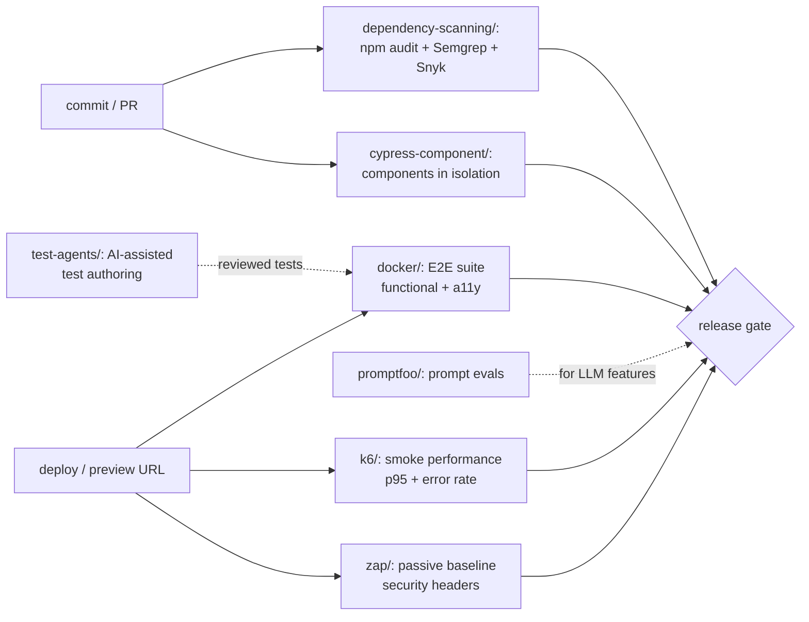

# QA toolbox — small, modular, reusable proofs

by **Romulus Mirăuță** · MIT license

[](https://github.com/RomulusMirauta/qa-toolbox/actions/workflows/k6.yml) [](https://github.com/RomulusMirauta/qa-toolbox/actions/workflows/zap.yml) [](https://github.com/RomulusMirauta/qa-toolbox/actions/workflows/docker.yml) [](https://github.com/RomulusMirauta/qa-toolbox/actions/workflows/test-agents.yml) [](https://github.com/RomulusMirauta/qa-toolbox/actions/workflows/promptfoo.yml) [](https://github.com/RomulusMirauta/qa-toolbox/actions/workflows/dependency-scanning.yml) [](https://github.com/RomulusMirauta/qa-toolbox/actions/workflows/cypress-component.yml)

Seven small, self-contained QA modules. Each one answers one question about a web app, runs locally with one
command, and runs in GitHub Actions through its own path-filtered workflow. The runtime modules point at the same
target, the public production app <https://romulus-mirauta.vercel.app> — **read-only and polite**: low request rates, no
authentication, passive security checks only. To use them on another app, change one URL (each module takes
`BASE_URL`, `TARGET_URL` or an argument). `dependency-scanning/` and `cypress-component/` need no target: one scans
code and dependencies, the other mounts UI components in a browser inside the runner.

| module | question it answers | tool | local command | CI workflow | status |
| --- | --- | --- | --- | --- | --- |
| [k6/](k6/) | Is it still fast and error-free under light concurrency? | k6 2.4 | `k6 run k6/smoke.js` | [k6.yml](.github/workflows/k6.yml) | verified |
| [zap/](zap/) | Are the security headers still there? Any new passive findings? | OWASP ZAP 2.17 baseline | `node zap/run.mjs` | [zap.yml](.github/workflows/zap.yml) | verified |
| [docker/](docker/) | Does the full E2E suite pass in a clean, reproducible container? | Playwright 1.65 image + Compose | `docker compose -f docker/compose.yaml run --rm tests` | [docker.yml](.github/workflows/docker.yml) | verified |
| [test-agents/](test-agents/) | Can AI agents plan, write and heal tests — and how are their proposals reviewed? | Playwright Test Agents + MCP | `node probe-mcp.mjs` / an AI client | [test-agents.yml](.github/workflows/test-agents.yml) | partial (agent loop TODO) |
| [promptfoo/](promptfoo/) | Does an LLM prompt keep its format and never leak personal data? | promptfoo 0.125 | `npm run eval:dry` / `npm run eval` | [promptfoo.yml](.github/workflows/promptfoo.yml) | verified (live eval 4/4) |
| [dependency-scanning/](dependency-scanning/) | Do our dependencies or our code carry known vulnerabilities? | npm audit, Semgrep 1.186, Snyk | `npm ci && npm run audit` | [dependency-scanning.yml](.github/workflows/dependency-scanning.yml) | verified |
| [cypress-component/](cypress-component/) | Does a UI component render, validate, stay accessible and call back correctly — in isolation? | Cypress 16.3 component testing (React + Vite) | `npm ci && npm run test:component` | [cypress-component.yml](.github/workflows/cypress-component.yml) | verified (10/10 locally) |

Every module folder has a README with **what / why / how to run / sample output**, and a `samples/` folder with
small, real outputs from a run (promptfoo keeps both: a labeled dry run and a live run). Statuses are honest:
"partial" means a part was not run, and the module README says which part and why.

## How the modules plug together

They are independent — copy one folder and its workflow into another repo and it works — but they are designed as
stages of one release pipeline for a web app:



- **Same input.** Every runtime module takes the URL of a deployment, so a preview deployment can be gated before
  it is promoted: run `docker/`, `k6/` and `zap/` against the preview URL in parallel.
- **Same contract.** Exit code `0` = pass, non-zero = the gate failed; every module writes its reports into
  `<module>/out/`, and every workflow uploads them as an artifact.
- **Authoring vs. gating.** `test-agents/` produces tests (after human review) that end up in the suite `docker/`
  runs; `promptfoo/` gates prompts the way the suite gates UI changes.
- **Before the deploy.** `dependency-scanning/` gates the commit itself (dependencies and source, SARIF into code
  scanning) and re-runs weekly, because new advisories appear while the code stands still. Dependabot keeps every
  module's pinned versions current with one monthly pull request per ecosystem.
- **Fast feedback first.** `cypress-component/` tests single components on the commit, before any deployment
  exists: seconds per run, no network, no target app — the cheap layer below the E2E suite.

## Running everything locally

| need | for | install (Windows) |
| --- | --- | --- |
| Node 24 | zap, test-agents, promptfoo, dependency-scanning, cypress-component | `winget install OpenJS.NodeJS.LTS` |
| k6 | k6 | `winget install GrafanaLabs.k6` |
| Docker Desktop | zap, docker | `winget install Docker.DockerDesktop` (needs WSL 2) |

```bash
k6 run k6/smoke.js
node zap/run.mjs
docker compose -f docker/compose.yaml run --rm tests
(cd test-agents && npm ci && npx playwright install chromium && npx playwright test && node probe-mcp.mjs)
(cd promptfoo && npm install && npm run eval:dry; node check-dry-run.mjs)
(cd dependency-scanning && npm ci && npm test && npm run audit:summary && npm run audit)
(cd cypress-component && npm ci && npx cypress install && npm run test:summary)
```

## Ground rules

- **Target etiquette.** At most 5 virtual users for under a minute (k6); a one-minute spider and passive rules only
  (ZAP); a modest worker count for the E2E suite. Nothing here sends attack payloads or writes data. Scan only what
  you own or have permission to test.
- **No secrets in the repo.** API keys come from the environment or from repository secrets; `.env*` is ignored.
  Samples were checked for personal data and secrets before they were saved.
- **Pinned tools.** GitHub Actions are pinned to a commit SHA (with the version in a comment), Docker images to an
  exact version tag, npm packages to exact versions.

## License

[MIT](LICENSE) © 2026 Romulus Mirăuță
